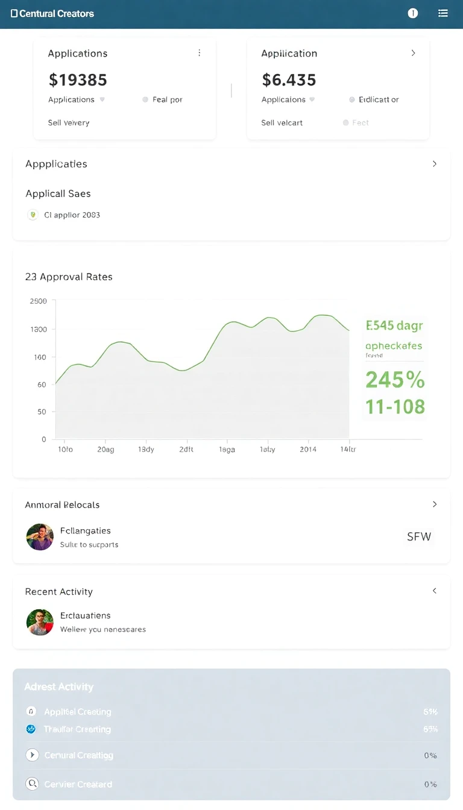
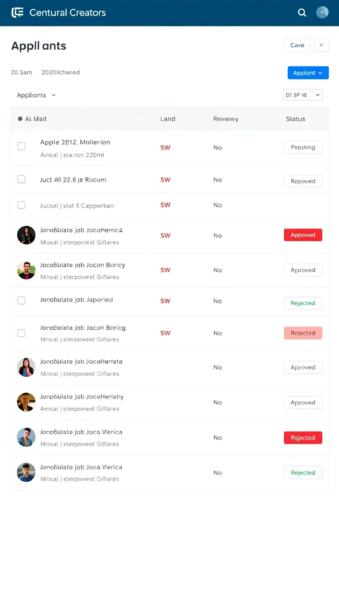
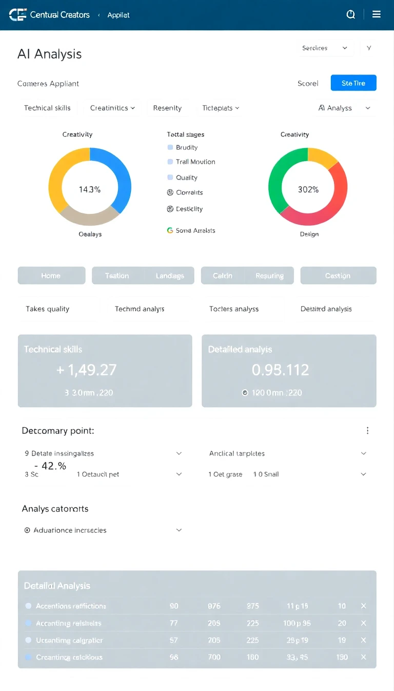

# Centural Creators Admin Panel & AI Analysis System
    

    
A comprehensive admin panel and AI-powered analysis system for managing applications to the Centural Creators platform. This system allows team administrators to efficiently review, analyze, and process creator applications at scale.
    
## Features
    
- **Dashboard**: Get a visual overview of application statistics and recent activity
- **Applicant Management**: Review and process applications with filtering and sorting capabilities
- **AI Analysis**: Automated evaluation of applicant portfolios and code samples
- **Settings**: Configure AI analysis parameters and system preferences
    
## Screenshots
    
### Dashboard

    
### Applicant Management

    
### AI Analysis

    
## Technology Stack
    
- **Frontend**: Vue.js 3, Chart.js for data visualization
- **Data Storage**: Flexible database architecture (supports multiple backends)
- **AI Analysis**: Modular AI service for evaluating creator portfolios
- **Architecture**: Modular services with clear separation of concerns
    
## System Requirements
    
- **Server**: Any static file server (Apache, Nginx, etc.)
- **Browser**: Modern web browser with JavaScript support
- **API Access**: API key for backend services (if connected to production backend)
    
## Quick Start
    
1. Clone this repository
2. Open `index.html` in your web browser for development mode with mock data
3. For production setup, follow the [Setup Guide](docs/setup-guide.md)
    
## Documentation
    
- [System Architecture & Technical Documentation](docs/documentation.md)
- [Setup Guide](docs/setup-guide.md)
- [Database Schema](docs/database-schema.md)
    
## Scalability
    
The system is designed to handle 1000+ applicants with the following features:
    
- Efficient data loading and pagination
- Caching of analysis results
- Optimized rendering of large data sets
- Asynchronous processing of AI analysis tasks
    
## Security
    
- Role-based access control
- API key management
- Secure data handling practices
    
## Development
    
### Project Structure
    
```
├── index.html          # Main HTML file
├── styles/             # CSS styles
│   └── main.css        # Main stylesheet
├── js/                 # JavaScript files
│   ├── app.js          # Main application logic
│   ├── api-service.js  # API communication service
│   ├── database-service.js  # Database operations
│   └── ai-analysis-service.js  # AI analysis functionality
├── images/             # Image assets
│   └── logo.png        # Centural Creators logo
├── docs/               # Documentation files
│   ├── documentation.md  # Technical documentation
│   ├── setup-guide.md  # Installation guide
│   ├── database-schema.md  # Database schema
│   └── screenshots/    # UI screenshots
└── LICENSE             # License file
```
    
### Contributing
    
Contributions are welcome! Please follow these steps to contribute:
    
1. Fork the repository
2. Create a feature branch: `git checkout -b feature-name`
3. Commit your changes: `git commit -m 'Add some feature'`
4. Push to the branch: `git push origin feature-name`
5. Submit a pull request
    
## License
    
[MIT License](LICENSE)
    
## Contact
    
For questions or support, please contact @api, the Team Lead for Centural Creators.